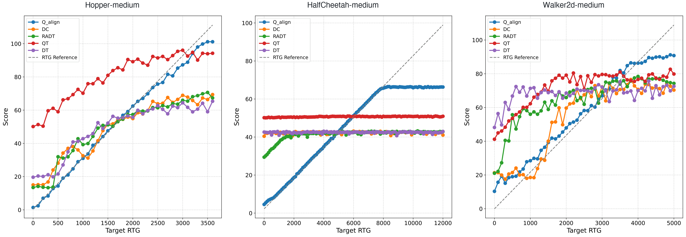
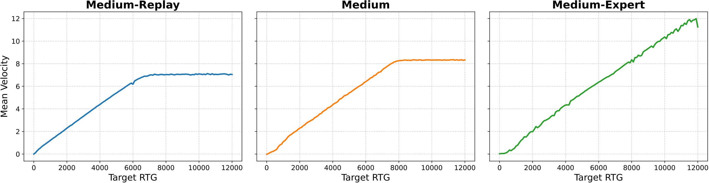
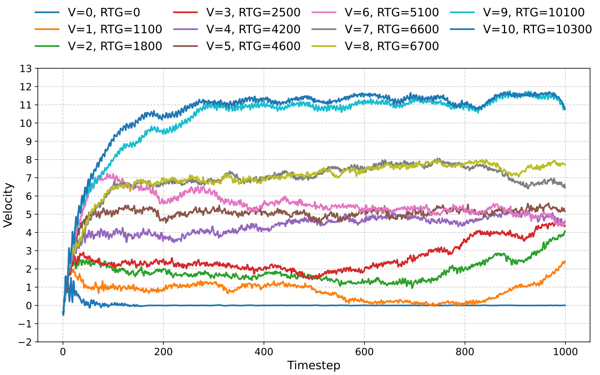

<div align="center">

# Q-Align DT

### Return-to-Go Is More Than a Number<br>Q-Guided Alignment for Return-Conditioned Supervised Learning

**Yuxiao Yang · Weitong Zhang**<br>
University of North Carolina at Chapel Hill · **ICML 2026**

[](https://arxiv.org/abs/2605.29028) [](https://proceedings.mlr.press/v306/yang26dn.html) [](https://arxiv.org/pdf/2605.29028)

**Learning policies whose behavior responds to the return you ask for.**

[Overview](#overview) · [Results](#results) · [Getting Started](#getting-started) · [Citation](#citation)

</div>

---

<p align="center">
  
</p>

**Does changing the target return actually change the policy?** Q-Align DT follows the requested return more closely across these D4RL tasks. The blue curve is our method; the dashed line marks ideal RTG alignment. Each point averages 30 rollouts. Adapted from Figure 1 of the [paper](https://arxiv.org/html/2605.29028v1#S1.F1).

## Overview

This repository contains the official implementation of **Q-Align DT**. Return-to-go (RTG) is intended to specify the performance a policy should achieve, yet sequence models can respond weakly to this input. We introduce Q-guided alignment to make the relationship between requested return and realized behavior explicit.

- **RTG-to-behavior alignment.** An auxiliary Q-function guides the policy so that increasing the target RTG encourages higher-value actions.
- **Policy–critic co-training.** RTG perturbations support joint learning of the policy and critic while retaining the supervised learning objective on offline trajectories.
- **Controllable behavior.** A single model learns a family of return-conditioned policies, with experiments on D4RL and zero-shot transfer to velocity tracking.

## Results

### From target returns to controllable speed

<p align="center">
  
</p>

**RTG controls more than a score.** Higher target returns induce faster locomotion across three HalfCheetah datasets, revealing a connection between the scalar conditioning signal and the agent's behavior (paper, Figure 3).

<details>
<summary><b>See velocity throughout individual rollouts</b></summary>

<p align="center">
  
</p>

Different target RTGs produce distinct velocity profiles on HalfCheetah-medium-expert. Curves average 30 runs (paper, Figure 4).

</details>

### Zero-shot velocity tracking

A model trained on **HalfCheetah-medium-expert** transfers to **HalfCheetah-vel**, with target RTGs selected by linear interpolation under the paper's shared adjustment protocol. Selected cross-domain results from Table 5 are shown below; all methods in this table use the same source dataset.

| Method | Average episode return ↑ |
| :--- | ---: |
| DT | -764.6 |
| RADT | -754.7 |
| QT | -824.6 |
| QCS | -1298.7 |
| **Q-Align DT** | **-142.3** |

See the [paper](https://arxiv.org/abs/2605.29028) for the full D4RL comparisons, alignment metrics, transfer protocol, and ablations.

## Getting Started

The training scripts live in [`QT/`](QT). Run the commands below from that directory:

```bash
cd QT
```

After setting up the [QT environment](https://github.com/charleshsc/QT), make sure the Python dependencies used by Decision Transformer / D4RL experiments are available, including:

- PyTorch
- Gym
- D4RL
- MuJoCo / mujoco-py dependencies required by D4RL
- NumPy, pandas, tqdm, wandb

Prepare the D4RL trajectory pickle files and pretrained critic checkpoints before training. By default, the example below expects:

```text
./data/halfcheetah-medium-v2.pkl
./saved_q_halfcheetah-medium-v2/Q_bc.pt
```

You can also pass another dataset directory through `--data_root` and another critic checkpoint through `--pretrain_q_path`.

### Pretrain the Critic

```bash
python pretrain_q.py --env halfcheetah-medium-expert-v2 --q_layernorm --gamma 0.99 
```

### Run Example

```bash
SAVE_PATH=./results/
ENV=halfcheetah
Dataset=medium

python experiment.py --seed 2 \
    --env $ENV --dataset $Dataset \
    --eta2 5 --grad_norm 15 \
    --exp_name qtc --save_path $SAVE_PATH \
    --max_iters 500 --num_steps_per_iter 1000 --lr_decay --K 20 --early_epoch 200 \
    --early_stop --use_discount --infer_no_q --alg alignment-sequence \
    --alignment_function relu_min --pretrain_q_path ./saved_q_${ENV}-${Dataset}-v2/Q_bc.pt --target_rtg 10
```

The command saves checkpoints under `SAVE_PATH`. Training logs are written to the same run directory.

## Citation

If you find this work useful, please cite our paper:

```bibtex
@inproceedings{yang2026return,
  title     = {Return-to-Go Is More Than a Number: Q-Guided Alignment for Return-Conditioned Supervised Learning},
  author    = {Yang, Yuxiao and Zhang, Weitong},
  booktitle = {Proceedings of the 43rd International Conference on Machine Learning},
  series    = {Proceedings of Machine Learning Research},
  volume    = {306},
  pages     = {147108--147135},
  year      = {2026},
  publisher = {PMLR},
  url       = {https://proceedings.mlr.press/v306/yang26dn.html}
}
```

## Acknowledgements

This codebase is built upon the official implementation of [QT](https://github.com/charleshsc/QT). We thank the authors for releasing their code. Please follow the original QT repository to set up the base environment, then prepare the additional data and critic checkpoints described above.

The figures shown here are taken from our [paper](https://arxiv.org/abs/2605.29028); the first combines its three Figure 1 panels for display.
